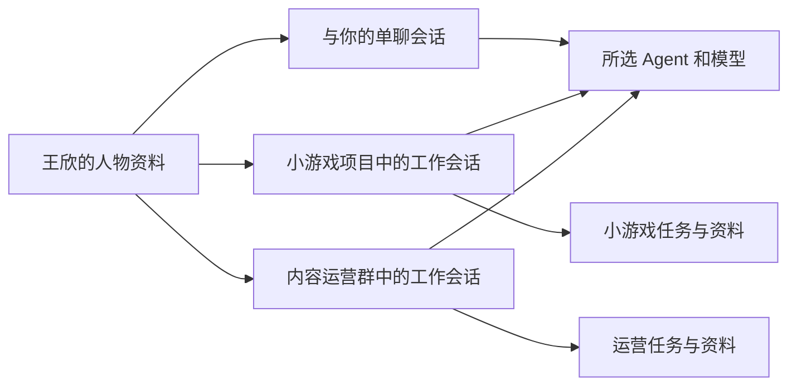

# Piko 个人 Agent 工作台改造方案

日期：2026 年 10 月 4 日。状态：待你审阅的产品与实施方案。

Piko 转向个人日常工作：你创建长期使用的 AI 同事，为每个人选择 Agent、模型和技能，平时单聊，需要协作时按项目或用途拉群。产品经理可以持续跟进项目并定时汇报，研究助理可以整理资料，开发和设计可以共同完成作品。

本轮已检查本机工具、项目实现和官方接入资料，并验证部分程序接口。下面的交互和功能属于拟实施内容，尚未宣称五个 Agent 已全部接入 Piko。沿用你之前先审阅方案再改主界面的安排；企业版工作停止。

## 你会怎样使用

第一次打开「Agent 接入」，应用检测已有工具，引导缺少配置的工具登录或填写自己的模型服务。完成一次接入后，创建人物只需选择 Agent 和模型；多个不同人物可以共用同一种 Agent。

例如创建「王欣 · 产品经理」，选 Codex，再从它的模型列表选择一个模型，勾选「产品需求梳理」「项目进度汇总」。以后左侧一直有王欣的单聊入口。换模型不会删掉王欣的人物资料、聊天记录或群成员关系。

创建「小游戏项目」群时，勾选王欣、许琳和张伟即可。也可以单独把王欣拉进「每日产品进度」群。人数由你选择，允许只与你和一个 AI 同事组成群；不强制添加负责人、开发者或审查者。原有角色和自定义角色都能用。

示例群聊：

> 你：这周把小游戏的手机版做完。
>
> 王欣：@许琳 整理手机操作方案；@张伟 根据确认后的方案实现。
>
> 许琳：已提交操作方案，查看附件。
>
> 张伟：已开始实现，预计先完成触控，再处理暂停恢复。
>
> 王欣：今天完成触控方案，开发进行中；还有一个待你决定的问题。

这些分工必须对应真实任务和状态变化。群里显示分派、进展、结果和需要你决定的事项；点击人物或任务卡片可进入相关执行记录。不会把一句「已分配」当作分配成功。

## 界面与操作

| 位置 | 拟提供的操作 |
| --- | --- |
| 左侧会话列表 | 单聊、项目群、功能群，支持搜索、置顶、未读和正在工作标记 |
| 新建人物 | 头像、姓名、岗位、Agent、模型；技能与工作范围放在可展开区域 |
| 新建群聊 | 填群名、勾选已有联系人，可绑定项目目录，可选择协调人 |
| 中间聊天区域 | 日常消息、简洁任务卡、文件交付、执行失败和待确认事项 |
| 右侧详情区域 | 按需展开群成员、任务、文件、定时任务和配置 |
| Agent 接入页 | 工具来源、版本、连接状态、模型列表、登录入口和连接检测 |

保留现有浅色界面、中英文切换、人物形象和多个办公室场景。聊天作为主入口，办公室作为可切换的展示视图。顶部按钮和底部输入框占独立区域，正文滚动不会挡住它们。

人物的 Agent 为单选项；建群的人物名单为多选项。模型默认「跟随该 Agent 的默认设置」，你也可以为某个人单独固定模型。运行中的任务保持原设置，切换从下一次任务生效。

## 五个 Agent 的实际检查结果

以下是本机检查结果，不等于五个引擎都完成了真实任务验收。本轮没有发送模型推理任务，也没有替你登录新账号。

| Agent | 本机发现 | 已验证内容 | 接入决定与剩余事项 |
| --- | --- | --- | --- |
| Codex | PATH 中为 0.135.0；现有解析器选到桌面应用附带的 0.159.2 | 独立启动 App Server 并读取模型目录，返回 8 个条目 | 使用 App Server 管理会话、流式输出和模型选择；模型调用权限仍需实际请求验证 |
| Pi | 官方包 `@earendil-works/pi-coding-agent`，0.84.2 | RPC 模型目录返回 388 个条目，包含已配置提供方下的模型 | 使用 RPC；按提供方分组、搜索和收藏，避免长列表；修复项目对 Pi 的错误检测 |
| DeepSeek Harness | 官方 `@deepseek-ai/dsh`，0.1.5-rc.3 | 在独立检查目录初始化 headless profile 并正常显示帮助 | 用 Piko 独立配置目录接入；本次检查发现旧 web profile 的 195 个依赖链接均已失效，不直接复用旧运行目录 |
| Kimi Code | 官方 `kimi`，2.1.0 | 支持非交互调用、模型参数和 ACP；提供方列表显示未配置 | 优先 ACP；首次使用需要你完成登录或配置自己的提供方，然后读取实际可选模型 |
| ZCode | 已有 `zcode-app-cli` 社区包 3.14.3-28，运行时报告 0.16.9 | 命令帮助确认有 App Server、单次提示和会话恢复入口 | 优先评估官方 CLI；现有社区客户端作为明确标注的实验接入，不能标成官方客户端；模型接口和任务流程还需验证 |

不需要把五套桌面应用都装一遍。Piko 应调用它们的 CLI、RPC 或 SDK。对于当前机器，重点是补齐接入、配置和会话管理，而不是重复下载现有工具。

模型列表会动态获取或从该引擎的配置读取，保留「尚未验证」状态。目录里出现某个模型，不能证明账号有额度、网络正常或模型请求一定成功。首次连接测试通过后再显示「已验证」，并记录测试时间。Codex 官方接口支持模型目录查询，但也明确说明目录不等于账户调用权限。[模型目录接口](https://learn.chatgpt.com/docs/app-server#models)，[目录与调用权限说明](https://developers.openai.com/siwc/token-sharing-open-source/codex-app-server)。

Pi 提供 RPC 与模型切换能力，适合由 Piko 承接聊天界面。[Pi 官方文档入口](https://pi.dev/)。Kimi 新版与旧版 CLI 存在差异，适配器按本机检测到的版本选择协议，不混用旧参数。[Kimi Code 官方入门](https://www.kimi.ai/help/kimi-code/cli-getting-started)。

DSH 的默认入口是本地 Web 服务，但也提供其他运行形式；本机 headless 入口只确认支持任务文本，不能擅自给它拼接未经验证的模型参数。接入时需要独立适配模型配置、流式事件和取消任务。[DSH 官方项目](https://github.com/deepseek-ai/deepseek-harness)。ZCode 官方仓库已经包含 CLI 和运行时源码，正式接入优先以此为依据，不将目前安装的社区包装误认为官方发布包。[ZCode 官方源码与运行说明](https://github.com/zai-org/ZCode)。

## 人物 职责 技能与模型

人物是你长期使用的 AI 同事。Agent 是它执行工作的程序，模型是该程序调用的推理服务。这三者分别保存，避免换一个模型就相当于重新招人。

| 设置 | 作用 | 示例 |
| --- | --- | --- |
| 人物 | 姓名、头像、沟通方式和长期职责 | 王欣，产品经理，先说结论再列风险 |
| Agent | 执行任务、使用工具和维护会话 | Codex、Pi、DSH、Kimi Code、ZCode |
| 模型 | 在该 Agent 的可用配置内选择 | 使用其默认模型，或固定一个模型 |
| Skills | 为人物选择的具体工作方法 | 需求分析、竞品研究、进度汇总 |
| 工具与文件范围 | 它能读取哪些资料、执行哪些操作 | 指定项目目录、浏览器或已连接的飞书能力 |

拟将人物职责保存为可编辑的 `role.md`，沟通风格可保存为 `soul.md`，绑定关系和技能清单保存为结构化配置。文件名只是组织方式，Piko 必须明确加载并交给各引擎，不能假定每家 Agent 都会自动识别它们。

技能在人物详情中勾选，并记录版本。产品经理可以装产品与研究技能，设计师装设计技能，开发者装代码与测试技能。团队创建和单人创建使用同一套加载流程，避免目前的两条路径行为不一致。

工具能力单独管理。技能描述本身不能授予权限；界面只展示该引擎确实支持的控制项。对于无法限制全局技能或工具发现的引擎，明确提示实际行为，不声称已经按人物完全隔离。

## 单聊和多群如何保持上下文

同一个王欣可以在多个群里工作，但每个群使用独立的执行会话。她共享自己的职责、风格和你明确保存的偏好，各项目的对话、文件范围和任务记忆分别保存。

每个人仍然只有一个联系人入口。进入单聊后，可以切换「直接对话」「小游戏项目」「内容运营」查看其相关工作记录；消息发送到当前明确选中的范围。不同项目的执行日志不会被拼成一份模型上下文。

群协作时传递任务说明、必要的群决策和引用文件。成员不会自动拿到其他人物的完整私聊。跨项目汇报需要明确选择来源项目，例如让王欣汇总你指定的三个项目，而不是扫描全部聊天。

切换 Agent 时保留可见记录，创建新引擎会话，并按当前范围传入工作摘要。界面显示一次切换记录，不假装不同引擎的原生会话能直接互换。上下文分开也不代表文件沙箱已经分开；文件访问范围必须另行落实。

## 群协作的执行规则

普通消息默认交给群协调人；`@某人` 直接指定执行者；多选成员可以创建并行任务。未设置协调人的群要求明确指定成员，避免所有人同时响应。项目群可以由产品经理协调，研究群可以由研究助理协调，负责人不是固定职位。

分配操作需要生成可追踪的任务记录，绑定群、执行人、工作范围和任务编号。状态为「待执行、执行中、等待你、完成、失败、已取消」，模型正文中的「完成了」不直接决定任务状态。

成员交付后，将摘要和文件链接回传原群，详细过程留在对应工作会话。协作设置并发上限和自动接力次数上限，任务支持停止和重试。同一人物可以跨群排队处理任务；涉及同一批文件的修改需要协调，不能因为上下文独立就任由写入相互覆盖。

## 产品经理每天汇报

你在群里说「每个工作日 18 点，让王欣汇报这个项目进度」，应用生成一张可查看和修改的定时任务卡：执行人、时间与时区、项目范围、汇报内容、发送位置。

汇报默认包含已完成事项、进行中事项、阻塞点、需要你决定的问题和下一步，并附相关任务或文件依据。没有新进展时如实说明；数据不足时指出缺什么，不能从聊天气氛推断项目已完成。

第一版任务保存在本机，应用重启后仍存在。Mac 醒着且 Piko 在后台运行时可按时执行；休眠、关机或退出应用时无法保证准点。恢复运行后最多补执行一次，并标明补执行时间，不把错过的多份日报全部排队发送。

默认发到应用内单聊或群聊，支持 macOS 通知。已有飞书接入可以后续接到同一任务系统；只有你为任务选择并配置飞书目标时才向飞书发送。示例中的时间只是产品说明，本轮未创建任何真实定时任务。

## 现有项目需要修改的地方

当前已有聊天界面、人物、任务队列、桌面外壳和 Codex 调用基础，可以复用。主要变化发生在人物与会话的关系、执行协议和配置链路。

| 现状 | 改造内容 |
| --- | --- |
| 每个执行 Agent 只有一个 `teamId` | 新增独立联系人、群和成员关系，使一个人物能加入多个群 |
| 群消息绑定负责人，团队成员单聊受限制 | 单聊独立可用；群按协调人或明确的 @ 目标路由 |
| 现有 `AIBackend.buildArgs` 主要拼命令行 | 增加统一适配接口，分别处理会话、事件、模型、取消和交互确认 |
| 人物选择主要选择 backend | 补齐单人、组队、加成员三条路径的模型和技能配置，并保存到任务与会话 |
| Pi 检测要求版本输出含 `pi`，实际仅输出版本号 | 用经验证的身份检测方式，避免误判未安装 |
| 单人创建会加载技能，团队创建没有沿用同一流程 | 提取共同的人物配置与技能加载逻辑 |
| 内置人物定义和提示词在启动时会重建或写回 | 将系统默认值与用户修改分开，启动不覆盖自定义职责与技能 |
| 工作流仍围绕软件开发阶段 | 增加通用任务类型，产品、研究、写作等任务不强制经过代码审查与网站预览 |

涉及的主要代码：`apps/gateway/src/backends.ts`、`apps/gateway/src/index.ts`、`packages/orchestrator/src/agent-session.ts`、`packages/shared/src/commands.ts`、`apps/web/src/components/office/ui/MessengerWorkspace.tsx` 和人物选择相关组件。

拟新增持久化对象：`Person`、`Conversation`、`Membership`、`ExecutionSession`、`Task`、`Schedule`。执行会话至少绑定人物、会话范围、Agent 和引擎会话编号；定时任务的执行记录使用唯一触发编号防止重启后重复执行。

使用本地数据库保存这些关系和任务状态，文件产物保存在工作目录。角色与技能保留为可编辑文件。模型密钥由相应工具或系统钥匙串保存，不写入人物文件、聊天或仓库。

旧人物、头像、聊天与团队做一次可回退的迁移：旧团队映射为群，旧人物映射为联系人，保留原执行记录。原历史无法可靠区分私聊与群任务时，标记为「历史记录」，不编造归属。先备份，再验证迁移数量和内容。

## 实施顺序与验收

| 批次 | 交付 | 验收条件 |
| --- | --- | --- |
| 第一批 Agent 与模型接入 | 接入管理、版本检测、动态模型列表、人物绑定、清晰的登录状态 | 五种 Agent 都有明确状态；完成配置的引擎能在 Piko 中真实执行任务；未完成配置不能假装可用；中文输入、取消、恢复和错误提示可验证 |
| 第二批 联系人与群聊 | 独立单聊、从已有联系人拉群、项目范围、协调人和 @ 派任务 | 同一个人物同时加入两个群；任务发给正确的人；各项目上下文不混用；取消真实停止对应任务 |
| 第三批 角色 技能与日常任务 | 通用工作流程、人物技能、资料和交付入口 | 产品经理能交付需求文档，研究助理能输出有来源的报告；创建方式不同不会导致技能丢失 |
| 第四批 定时汇报与桌面交付 | 定时任务卡、持久化调度、补执行、通知、更新 Mac 应用 | 自动汇报能追溯数据；重启不重复执行；睡眠恢复行为正确；旧人物、群和历史完整保留 |

第一批接入验证采用短小、明确的任务，不先运行五个完整项目。各 Agent 独立登录，各自使用账号或 API 的额度。遇到登录、订阅或连接问题，在接入页指出具体缺项，不静默切换到另一种 Agent 或模型。

整体验收使用「小游戏项目＋日常产品进度」两个群：已有产品经理同时入群，与设计和开发配合完成一个小任务，生成可打开的交付物，再由产品经理按计划汇总。验收包括桌面实际操作，不能只凭编译通过判定完成。

## 本轮完成情况

- 已确认五个命令入口存在，并区分官方包与 ZCode 社区客户端；本轮没有重复安装这些工具。
- 已通过 Codex App Server 和 Pi RPC 读取模型目录，检查报告保存在 `.review-runtime/personal-agent-audit/model-catalog-check.json`。
- 已在独立检查目录初始化 DSH headless profile 并验证帮助入口；没有改写原 DSH 的配置与历史。
- 已确认 Kimi 当前没有配置提供方，完整接入需要首次登录或模型配置。
- 已核实当前群关系、模型参数、技能加载和 Pi 检测的改造点。
- 尚未修改主界面、迁移旧数据、运行付费模型测试或创建真实定时汇报；以上功能进入方案审阅后的实施范围。
