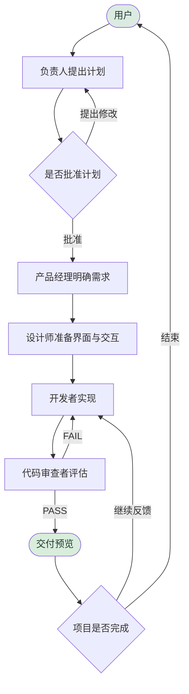

# Piko 团队工作流

[English](team-workflow.md) · [中文文档目录](DOCUMENTATION.zh-CN.md)

本文说明 Piko 的团队协作行为。

## 总体流程

## 团队阶段

| 阶段 | 系统行为 | 用户操作 |
|---|---|---|
| Create | 负责人收集意图和范围 | 描述想做什么 |
| Design | 负责人提出实施计划 | 批准或提出修改 |
| Execute | 开发者实现，审查者验证；按需先完成产品和设计 | 查看进展或取消 |
| Complete | 团队返回预览和总结 | 提出反馈或结束项目 |

## 团队角色

| 角色 | 职责 |
|---|---|
| 负责人 | 确定方向、拆解工作并协调分派 |
| 产品经理 | 明确需求、范围和验收标准 |
| 界面设计师 | 定义布局、视觉系统和交互 |
| 开发者 | 编写和修改代码、运行构建与测试、整合修复 |
| 代码审查者 | 检查质量和需求符合情况，给出 PASS/FAIL |

## 控制循环

- 设计循环：负责人根据反馈修改计划，直到批准。
- 审查循环：审查者将问题交回开发者，重试次数有上限。
- 交付循环：用户查看预览后提出修改，或结束任务。

## 预览解析

任务完成时，Piko 尝试让结果可立即查看：

| 产物类型 | 处理方式 |
|---|---|
| 静态文件（html/css/js） | 直接提供静态服务 |
| 构建产物（dist/、out/） | 作为静态站点提供服务 |
| 可运行服务（Express、Flask 等） | 启动服务并解析预览地址 |

## 默认团队与候选成员

| 姓名 | 岗位 | 主要方向 |
|---|---|---|
| 陈峰 | 负责人 | 规划与分派 |
| 王欣 | 产品经理 | 需求和验收标准 |
| 许琳 | 界面设计师 | 视觉和交互设计 |
| 张伟 | 开发者 | 通用开发 |
| 李敏 | 审查者 | 代码质量 |
| 林悦 | 开发者 | 前端 |
| 周宁 | 开发者 | 后端 |
| 赵凯 | 开发者 | 快速原型 |

## 说明

- 团队行为由 `packages/orchestrator` 编排。
- 提示词、任务分派、结果收尾和重试边界由编排运行时处理。
- 默认选择负责人、产品经理、设计师、开发者和审查者五人，也可以继续增加成员。
- 产品或设计步骤不适用、或已经完成时可以跳过；其交付内容与文件路径会转交后续成员。
